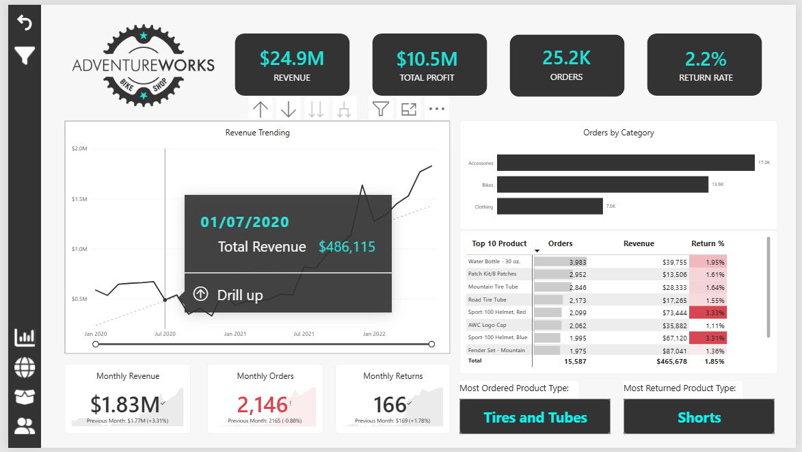
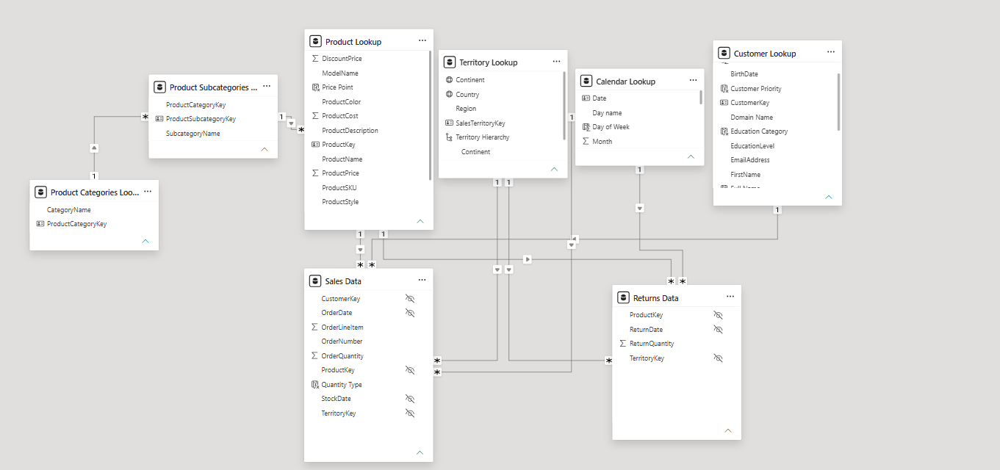
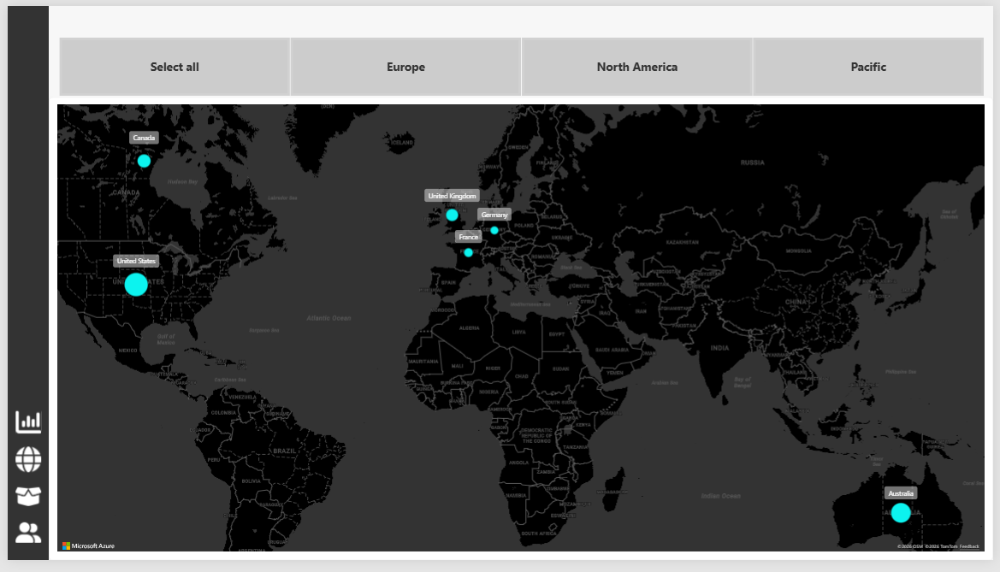
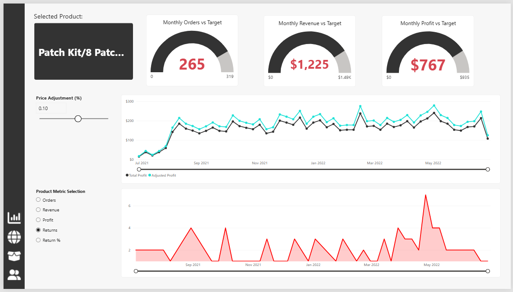
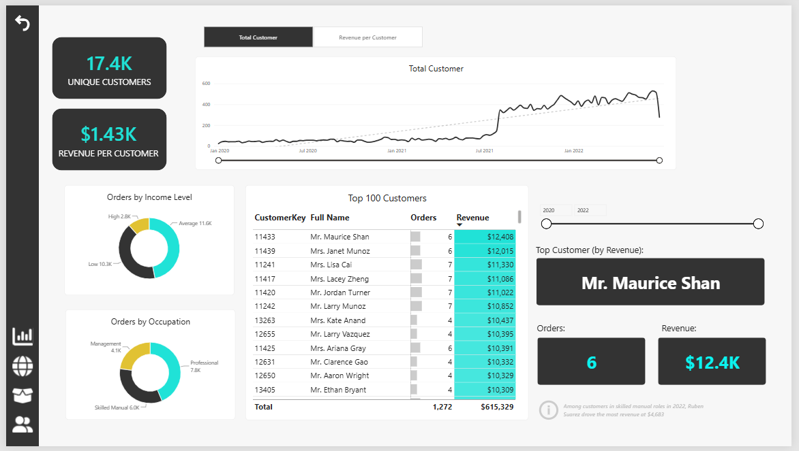
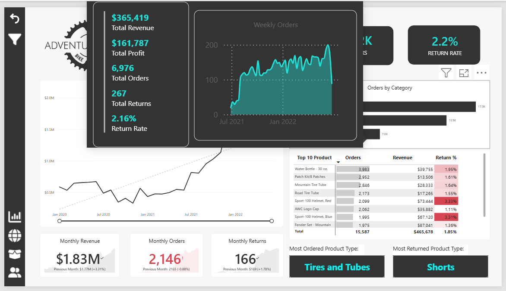

<div align="center">

# AdventureWorks Business Performance Dashboard

### An interactive Power BI report exploring sales, products, customers, and returns across 56,046 sales records.

**Power BI Desktop · Power Query · DAX · Dimensional Modelling**

[Portfolio](https://iffaaulia.github.io) · [Learning Journal](#learning-journal) · [Key Insights](#key-insights-and-recommendations)

</div>



## Table of Contents

- [Project Overview](#project-overview)
- [Business Problem and Objectives](#business-problem-and-objectives)
- [Dataset](#dataset)
- [Tools and Technologies](#tools-and-technologies)
- [Data Preparation](#data-preparation)
- [Data Model](#data-model)
- [Dashboard Walkthrough](#dashboard-walkthrough)
- [Key Features](#key-features)
- [DAX Measures](#dax-measures)
- [Key Insights and Recommendations](#key-insights-and-recommendations)
- [Learning Journal](#learning-journal)
- [How to Use This Project](#how-to-use-this-project)
- [Repository Structure](#repository-structure)
- [Skills Developed](#skills-developed)
- [Project Context and Limitations](#project-context-and-limitations)
- [About Me](#about-me)

## Project Overview

This is my **second business analysis portfolio project**, completed while following a **Maven Analytics Power BI course**. I worked through the full workflow: preparing CSV data in Power Query, building a connected model, creating DAX calculations, and designing four main interactive report pages.

My goal was to improve my Power BI skills while learning how to assess business performance. Beyond creating visuals, I practised explaining what a metric means, investigating patterns, and separating evidence from assumptions.

| Metric | Result |
| --- | ---: |
| Sales records | 56,046 |
| Distinct orders | 25,164 |
| Revenue | $24.91M |
| Product profit | $10.46M |
| Purchasing customers | 17,416 |
| Unit return ratio | 2.17% |
| Sales period | 1 January 2020 - 30 June 2022 |

Revenue and product profit use product lookup prices and costs. Product profit is not net income. The unit return ratio compares aggregate returned units with units sold, rather than matching each return to an original order.

## Business Problem and Objectives

This report is designed to help a business reviewer move from a performance summary to questions about products, customers, and markets.

1. How are revenue, profit, orders, and returns changing over time?
2. Which categories generate order volume, and which contribute revenue?
3. Which products warrant investigation for returns or target gaps?
4. How are orders distributed across countries?
5. How do customers contribute to revenue, and how do orders vary across customer groups?
6. How does a price adjustment change calculated profit under the scenario assumptions?

These are analytical objectives for a learning project, not requirements gathered from a real client.

## Dataset

The project uses **10 core CSV files**, organised into **8 core model tables**. A separate 20-row unpivot demonstration file is a practice input rather than part of this inventory.

| Source CSV | Original rows | Destination |
| --- | ---: | --- |
| AdventureWorks Calendar Lookup | 912 | Calendar Lookup |
| AdventureWorks Customer Lookup | 18,154 | Customer Lookup |
| AdventureWorks Product Categories Lookup | 4 | Product Categories Lookup |
| AdventureWorks Product Lookup | 293 | Product Lookup |
| AdventureWorks Product Subcategories Lookup | 37 | Product Subcategories Lookup |
| AdventureWorks Returns Data | 1,809 | Returns Data |
| AdventureWorks Sales Data 2020 | 2,630 | Sales Data |
| AdventureWorks Sales Data 2021 | 23,935 | Sales Data |
| AdventureWorks Sales Data 2022 | 29,481 | Sales Data |
| AdventureWorks Territory Lookup | 10 | Territory Lookup |

The three yearly sales files combine into **56,046 rows**. Counts above describe the original uploaded CSV records, excluding headers; they are not a blanket claim that every final query has the same row count.

**Data-quality note:** Customer Lookup contains repeated and empty source keys. This is documented in the learning journal and needs reconciliation with the final transformed query before the dimension is treated as fully validated. Its row count is different from the number of customers who actually purchased.

## Tools and Technologies

| Tool / technique | Purpose |
| --- | --- |
| Power BI Desktop | Semantic model, report layout, and interaction |
| Power Query (M) | Import, profiling, type conversion, combining files, and custom columns |
| DAX | Measures, calculated columns, calculated tables, and formatting helpers |
| CSV sources | Sales, returns, and lookup data |
| Field parameters | Switching the measure displayed by a visual |
| Numeric range parameter | Supplying a price-adjustment scenario input |

## Data Preparation

- Connected CSV data and reviewed column quality, distribution, and profiles.
- Assigned types suitable for identifiers, quantities, text, money, and dates.
- Combined the three yearly sales sources into a single Sales Data query.
- Created calendar attributes such as day/month names and period-start dates.
- Practised calculating a price after a 10% discount and extracting SKU categories.
- Extracted email domains and investigated CustomerKey duplication.
- Used Applied Steps to review the transformation sequence.

The Sales screenshot shows a folder-based **Combine Files** workflow, while my course notes also cover **Append Queries**. Both support combining rows; their exact setup differs.

[Read Part 1: Connecting and Shaping the Data](documentation/AdventureWorks-01-Connecting-and-Shaping-Data-English.pdf)

## Data Model



The model contains **two fact tables and six dimensions**, with a snowflake branch for product classification.

| Role | Tables |
| --- | --- |
| Facts | Sales Data; Returns Data |
| Shared dimensions | Product Lookup; Calendar Lookup; Territory Lookup |
| Customer dimension | Customer Lookup, related to Sales |
| Product snowflake dimensions | Product Subcategories Lookup; Product Categories Lookup |

**Modelling highlights**

- Lookup identifiers form the one side of one-to-many relationships.
- The product branch connects **Category → Subcategory → Product → facts**.
- Sales and Returns remain separate because they represent different grains.
- Customer does not directly relate to Returns; customer-level returns cannot be inferred from this model alone.
- Date and territory hierarchies support exploration at different levels.
- A dedicated Measure Table organises most calculations without requiring its own relationships.

[Read Part 2: Data Modelling](documentation/AdventureWorks-02-Data-Modelling-English.pdf)

## Dashboard Walkthrough

### 1. Executive Dashboard

The opening screenshot shows the executive page. KPI cards summarise revenue, profit, orders, and return rate, supported by:

- Revenue trend and monthly comparisons.
- Orders by product category.
- A Top 10 product matrix with orders, revenue, and return percentages.
- Product-type summary cards and contextual tooltips.
- Sidebar navigation and filters.

**Analytical purpose:** identify performance changes and choose where to investigate next.

### 2. Geographic Analysis



A country map displays order distribution. A continent selector supports regional exploration.

**Analytical purpose:** compare geographic order volume. Bubble size alone does not establish revenue contribution, profitability, or market potential.

### 3. Product Detail



- **Gauge charts** compare monthly orders, revenue, and profit against targets.
- A **field parameter** switches one chart between Orders, Revenue, Profit, Returns, and Return Rate.
- A **numeric range parameter** adjusts the scenario price input.
- Baseline and adjusted profit can be compared over time.
- The product selected from the executive table can be investigated in a focused detail view.

**Analytical purpose:** monitor target gaps and explore pricing assumptions. The scenario does not model customer demand response.

### 4. Customer Detail



- Distinct purchasing customers and revenue-per-customer KPIs.
- A customer trend chart with metric selection.
- Orders grouped by customer income and occupation.
- A Top 100 customer table and single-customer detail measures.

**Analytical purpose:** investigate customer contribution and patterns. The donut charts display **orders**, not customer counts or segment profit.

<details>
<summary><b>Additional preview: category tooltip</b></summary>



The tooltip adds revenue, profit, orders, returns, and weekly order context without placing every metric on the main canvas.

</details>

## Key Features

| Feature | What I learned / implemented |
| --- | --- |
| Sidebar navigation | Consistent movement between report pages |
| Contextual tooltips | Additional information during exploration |
| Gauge charts | Comparing performance with defined targets |
| Product field parameter | Five metrics in one reusable chart |
| Customer field parameter | Switching between customer count and revenue per customer |
| Numeric range parameter | Exploring price-adjustment scenarios |
| Conditional formatting | Colour helpers respond to the selected metric |
| Hierarchies | Structured exploration of dates and territories |
| Customer detail helpers | Output changes for single versus multiple customers |

## DAX Measures

The saved PBIX contains **44 measures, 12 calculated columns, and 3 calculated tables**. Some objects are learning exercises or helpers rather than measures currently displayed in a visual.

I organised **42 measures in Measure Table**. Two remain in Customer Lookup and the price-parameter table. A measures table is an organisational home, not a fact table or a way to change filter behaviour.

<details>
<summary><b>Core quantities, orders, and unit return rate</b></summary>

```dax
Quantity Sold = SUM('Sales Data'[OrderQuantity])

Quantity Returned = SUM('Returns Data'[ReturnQuantity])

Total Orders = DISTINCTCOUNT('Sales Data'[OrderNumber])

Total Customer = DISTINCTCOUNT('Sales Data'[CustomerKey])

Return Rate =
DIVIDE([Quantity Returned], [Quantity Sold], "No Sales")
```

The original Return Rate expression returns text when division is not possible. A purely numeric alternative could use BLANK(). Separately, `Total Returns` uses `COUNT` and therefore counts return records rather than returned units.

</details>

<details>
<summary><b>Revenue, product cost, and profit</b></summary>

```dax
Total Revenue =
SUMX(
    'Sales Data',
    'Sales Data'[OrderQuantity] * RELATED('Product Lookup'[ProductPrice])
)

Total Costs =
SUMX(
    'Sales Data',
    'Sales Data'[OrderQuantity] * RELATED('Product Lookup'[ProductCost])
)

Total Profit = [Total Revenue] - [Total Costs]
```

These calculations use catalogue prices and costs, not a complete accounting profit model.

</details>

<details>
<summary><b>Previous-month comparison and target</b></summary>

```dax
Previous Month Revenue =
CALCULATE(
    [Total Revenue],
    DATEADD('Calendar Lookup'[Date], -1, MONTH)
)

Revenue Target = [Previous Month Revenue] * 1.1

Revenue Target Gap = [Total Revenue] - [Revenue Target]
```

The target is a project rule of 110% of previous-month performance, not a verified stakeholder-approved target.

</details>

<details>
<summary><b>Price-adjustment scenario</b></summary>

```dax
Price Adjustment (%) Value =
SELECTEDVALUE('Price Adjustment (%)'[Price Adjustment (%)], 0)

Adjusted Price =
[Average Retail Price] * (1 + 'Price Adjustment (%)'[Price Adjustment (%) Value])

Adjusted Revenue =
SUMX('Sales Data', 'Sales Data'[OrderQuantity] * [Adjusted Price])

Adjusted Profit = [Adjusted Revenue] - [Total Costs]
```

The scenario retains observed quantities and existing costs. Validate single-product and aggregated behaviour before interpreting results; it is not a demand forecast.

</details>

[Read Part 3: Full DAX Catalogue and Measure Table Organisation](documentation/AdventureWorks-03-Learning-DAX-English.pdf)

## Key Insights and Recommendations

These observations come from the supplied CSVs and report. Recommendations are proposed next steps, not implemented business outcomes.

| Finding | Evidence | Recommended next step |
| --- | --- | --- |
| Revenue grew despite fewer orders | June 2022 revenue rose 3.31% versus May; orders fell 0.88%; revenue per order rose 4.23% | Investigate product mix and units per order before attributing the increase to pricing |
| Order popularity differs from revenue contribution | Accessories appeared in 16,983 orders versus Bikes in 13,929; Bikes generated 94.89% of revenue | Monitor Bikes performance and availability; test accessory bundles with incremental-profit measurement |
| Two helmet variants warrant review | Red and Blue Sport-100 Helmet unit return ratios were 3.33% and 3.31%, versus 2.17% overall | Investigate period/territory patterns and obtain return reasons before concluding a quality problem |
| Country order volume is only part of the picture | Australia: $7.42M from 6,060 orders; United States: $7.94M from 8,700 orders | Compare revenue per order and product mix before allocating market budgets |

**Interpretation notes:** category order counts overlap because one order can contain several categories. Return ratios aggregate returned and sold units rather than matching purchase cohorts. June/May revenue per order increased from **$816.83 to $851.35**; these figures are in the dataset's dollar-denominated presentation, not pounds sterling.

## Learning Journal

I documented the process as a learning journey, including definitions, screenshots, original formulas, and checks that still require attention.

| Part | Documentation |
| --- | --- |
| 01 | [Connecting and Shaping the Data](documentation/AdventureWorks-01-Connecting-and-Shaping-Data-English.pdf) |
| 02 | [Data Modelling](documentation/AdventureWorks-02-Data-Modelling-English.pdf) |
| 03 | [Learning DAX](documentation/AdventureWorks-03-Learning-DAX-English.pdf) |

## How to Use This Project

1. Download or clone this repository.
2. Open `AdventureWorks Report.pbix` in Power BI Desktop.
3. Explore the saved report pages and their available filters and selectors.
4. To refresh, obtain the original course CSVs and update the source file/folder paths in Power Query. Raw CSVs are not included in this package.
5. Use the learning PDFs to follow the preparation, modelling, and calculation stages.

```bash
git clone https://github.com/iffaaulia/adventureworks-powerbi-analysis.git
```

Use the sidebar to navigate, the continent selector for geographic exploration, and the metric/scenario selectors on the relevant detail pages. Confirm the configured product-detail navigation gesture in Desktop rather than assuming a table click alone changes pages.

## Repository Structure

| Path | Contents |
| --- | --- |
| `README.md` | Project overview, walkthrough, DAX examples, and insights |
| `AdventureWorks Report.pbix` | Power BI model and report |
| `screenshots/` | Executive, map, product, customer, tooltip, and model screenshots |
| `documentation/` | Three English learning PDFs and a supplementary project walkthrough |

## Skills Developed

- Data profiling and transformation using Power Query.
- Combining yearly transaction files.
- Fact/dimension modelling, relationships, and filter flow.
- DAX aggregation, iteration, time intelligence, and scenario calculations.
- Measure organisation and reusable logic.
- Interactive visual design with parameters, tooltips, and navigation.
- Business interpretation and communicating limitations.

## Project Context and Limitations

This is a **guided Maven Analytics course project**, presented as evidence of my learning and developing analytical skills. The implementation followed the course; no independent dashboard extension, client delivery, or realised business improvement is claimed.

Saved DAX expressions were extracted from the PBIX. Selected source totals were independently checked. This does not constitute a complete audit of Power Query steps, source-key cleanup, every relationship property, or every report interaction. Specific learning formulas and pending checks are documented in the PDFs.

## About Me

I am developing my business analysis and data analytics skills through practical projects, focusing on making complex data easier to understand.

**[GitHub](https://github.com/iffaaulia) · [Portfolio](https://iffaaulia.github.io)**

**Acknowledgment:** Maven Analytics provided the course and AdventureWorks learning materials used in this project.
